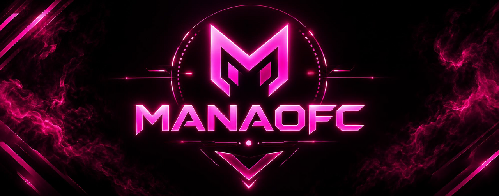

  

# 💫 About Me:
🔭 I’m currently working on 
👯 I’m looking to collaborate on 
🤝 I’m looking for help with 
🌱 I’m currently learning 
💬 Ask me about 
⚡ Fun fact

## 🌐 Socials:
 

# 💻 Tech Stack:
                        

# 📊 GitHub Stats:
 
 

## 🏆 GitHub Trophies

### ✍️ Random Dev Quote

### 🔝 Top Contributed Repo

---

## 💰 You can help me by Donating
    

  
<!-- Proudly created with GPRM ( https://gprm.itsvg.in ) -->
